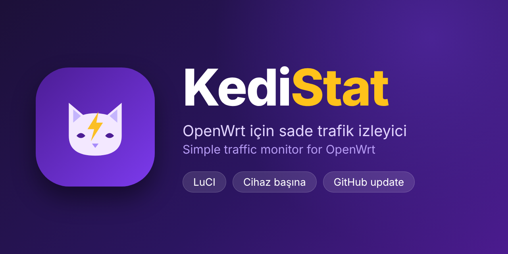
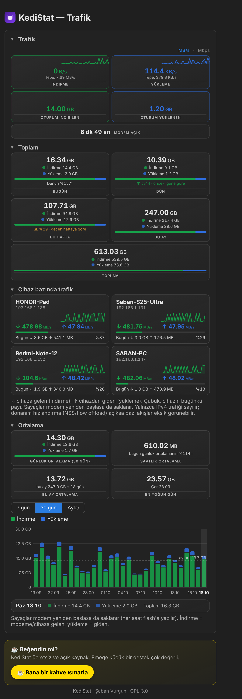
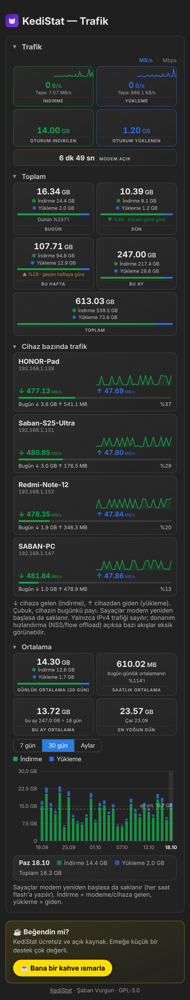

<p align="center"></p>

<p align="center"><a href="https://buymeacoffee.com/sabanvurgun"></a></p>

# KediStat

OpenWrt modemler için sade trafik izleyici (netstat mantığı): modemin toplam indirme/yükleme sayacı + cihaz başına indirme/yükleme. VPN/Direkt ayrımı yoktur.

## Kurulum

Modemde (SSH):

```
wget -qO- https://raw.githubusercontent.com/sabanvurgun03-ui/kedistat/main/kedistat-install.sh | sh
```

LuCI → **Araçlar** (yoksa **Hizmetler**) → **KediStat Trafik**.

## Ekran görüntüleri

<p align="center">&nbsp;&nbsp;</p>

*Örnek (sentetik) verilerle: canlı hız, dönem toplamları, cihaz kartları ve grafik.*

## Özellikler
- Canlı hız, oturum, bugün/dün/hafta/ay/toplam kartları ve önceki dönemle karşılaştırma
- Cihaz başına indirme/yükleme (IP, ad, MAC), bugün/hafta/ay/toplam
- 7 gün / 30 gün / 12 ay grafiği (üzerine gelince değerler)
- KediRay kuruluysa geçmiş verileri (günlük, aylık, cihaz başına) kurulumda otomatik içe aktarılır; elle: `kedistat import`
- Sayfadan GitHub güncellemesi: denetle / şimdi güncelle / günde bir otomatik denetim ve isteğe bağlı otomatik kurulum (sürüm aynı kalsa da depodaki yeni commit yakalanır)
- Yedekleme: panelden yedek dosyası indir / dosyadan geri yükle (`kedistat backup`, `kedistat restore-file`)
- Sayaçlar RAM'de tutulur, düzenli aralıkla flaşa yazılır; yeniden başlatmada geri yüklenir

## Komutlar
`kedistat stats | import | reset | version | update [check] | uninstall`

## Notlar
- Gereksinim: OpenWrt 22.03+ (fw4/nft), ucode, LuCI
- Cihaz başına sayım yalnızca IPv4; donanım hızlandırma (NSS/flow offload) bazı trafiği atlayabilir
- Lisans: GPL-3.0

## Destek

KediStat ücretsiz ve açık kaynak. Beğendiysen:

<p align="center"><a href="https://buymeacoffee.com/sabanvurgun"></a></p>
